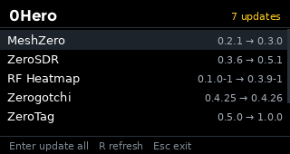

# 0Hero

One-tap updater for every app installed from the **CardputerZero App Store**.



The Store updates apps one at a time. 0Hero checks everything you installed against the official registry, shows what's out of date, and updates all of it with a single press of Enter. Apps you install later are picked up automatically, because 0Hero reads the Store's installed list every time it runs.

## Use it

On the device, open **0Hero** from the launcher.

| Key | Action |
| --- | --- |
| Enter | Update everything listed |
| R | Check again |
| ↑ / ↓ (or F / X) | Scroll |
| Esc | Exit (disabled while an install is running) |

Over SSH:

```sh
zerohero           # list available updates
zerohero --apply   # install them all
```

## How it works

0Hero adds no package logic of its own. For each app it drives the Store's own transaction flow, so the Store's records stay correct:

1. `M5CardputerZero-AppStore --prepare-package upgrade <uuid>` downloads and verifies the `.deb` (MD5/SHA-256 from the registry) and records a pending transaction.
2. The Store's root helper (`--package-helper`, run through `sudo`) installs the package, resolves any new dependencies, and marks the transaction complete.
3. `--finalize-package upgrade <uuid> <tx>` checks the real dpkg state and updates the Store's installed list.

If a transaction was left unfinished by a crash or power loss, 0Hero first asks the Store to reconcile it (`--repair-package-transaction`). If one app fails, the rest still get updated, and the summary screen lists the failures. 0Hero updates itself last, so a self-update never cuts a run short.

## Requirements

- CardputerZero running APPLaunch and the App Store
- Wi-Fi
- Passwordless `sudo` for the desktop user (the CardputerZero default). Without it 0Hero shows a clear message instead of updating.

## Build

```sh
./build.sh    # produces build/zerohero_<version>_all.deb, the icon and the screenshots
```

Then publish it with the CardputerZero AppBuilder: `czdev login`, then `czdev publish --deb build/zerohero_1.0.0_all.deb`.

## License

MIT © 2026 Irak4t0n
